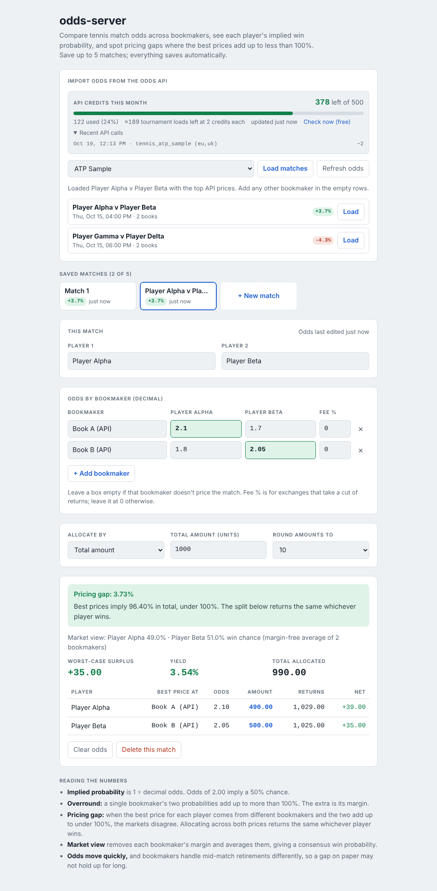
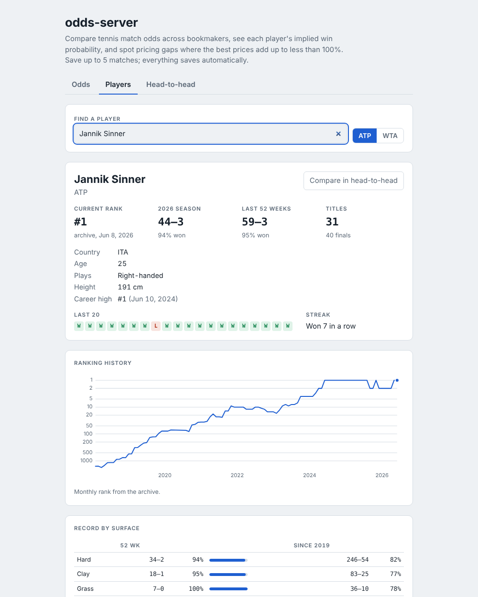
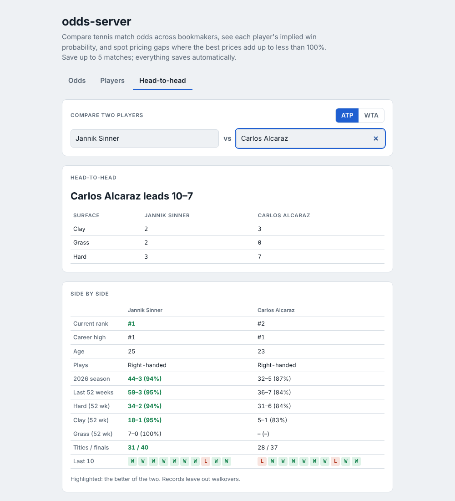

# 🎾 odds-server

**An odds observer for tennis fans.** It follows match odds across dozens of bookmakers, turns them into
win probabilities, and shows you where the market can't make up its mind.



Ever wondered why one site has Sinner at 1.45 and another at 1.52? Or what "2.10" actually says about a
player's chances? odds-server answers those questions for every match in a tournament, using only
Python's standard library and a single HTML page.

---

## What you can do with it

| Players | Head-to-head |
|---|---|
|  |  |

- **See the market's view of a match.** Every bookmaker's price is converted into an implied win
  probability. Their built-in margins are removed and the results are averaged into one consensus
  number per player.
- **Compare prices side by side.** The best price for each player is highlighted across all bookmakers.
- **Spot disagreements.** When the best prices for the two players add up to less than 100%, the
  bookmakers disagree about the match, and the match is flagged as a *pricing gap*.
- **Load a whole tournament at once.** Pick an event (say, WTA Ningbo or an ATP Masters), and every match
  is listed and sorted by how much the bookmakers disagree.
- **Save up to 5 matches** you're following. They're stored in your browser.
- **Watch your API usage.** A built-in meter tracks your free monthly credits.
- **Check out the players.** Current and career-high ranking, age, country and playing hand, the last 10
  results with scores, and their head-to-head record, right under every match.
- **Players tab.** Search any ATP or WTA player for a full profile: ranking history chart, this season and
  last-52-week records, win % by surface and by tournament level, titles and finals, recent form and streak.
  Works any day, even when no tournament has odds open.
- **Head-to-head tab.** Pick two players for their record against each other (overall and by surface), every
  meeting, and a side-by-side comparison of rank, form and records.
- **Use it from the terminal** with `scan.py`, if you prefer text output.

## The ideas behind it

### Odds are probabilities in disguise

Decimal odds tell you how many units come back per unit, so `2.50` returns 2.5×. Flip that around and you get
the implied probability:

```
p = 1 / odds          2.50  →  40.0%
```

### Bookmakers add a margin

A single bookmaker's two probabilities add up to more than 100%. At `1.90 / 1.90` you get 52.6% + 52.6% = 105.3%.
The extra 5.3% is the bookmaker's margin, also called the *overround*.

### Finding the "fair" probability

To remove the margin, rescale each bookmaker's pair so it sums to 100%, then average across all bookmakers:

```
fair_i = (1/odds_i) / (1/odds_1 + 1/odds_2)      averaged over bookmakers
```

This gives the **Market view**, the crowd's best guess at each player's chance.

### When the market disagrees

Take the *best* price for each player, even if they come from different bookmakers:

```
implied_total = 1/best_1 + 1/best_2
```

Normally this is still above 100%. When it drops below, bookmakers disagree enough to leave a **pricing gap** of
`1/implied_total − 1`. Example: `2.10` at one bookmaker and `2.05` at another give 47.6% + 48.8% = 96.4%, a 3.73% gap.

### Equal-return allocation

The page also shows how a total amount `T` would be spread across the two best prices so that it returns the same
whichever player wins:

```
amount_i = T × (1/best_i) / implied_total
```

With rounding switched on (for example to the nearest 10), each amount is tried rounded down and up, and the
combination with the best worst-case result is kept.

## Getting started

You'll need **Python 3.9+**. The odds features need no packages at all; player stats need one (see below).

1. **Get a free API key** from [the-odds-api.com](https://the-odds-api.com). The free plan gives 500 credits a month.
2. **Add your key.** Copy `.env.example` to `.env` and fill in `ODDS_API_KEY=...`.
3. **Start it:**
   - **Windows:** double-click `start.bat`.
   - **macOS / Linux:** `python3 server.py`.

   Your browser opens at http://127.0.0.1:8765.

No key? Open `web/odds-server-offline.html` directly and type odds in by hand.

### Player stats

Player stats need one extra package, so they use a virtual environment. Do this once:

```bash
# Windows: double-click setup.bat, then update.bat
python -m venv .venv
.venv/bin/pip install -r requirements.txt        # Windows: .venv\Scripts\pip ...
.venv/bin/python update_stats.py                 # first run: roughly 100–200 MB
```

After that, run `update.bat` **weekly** to pick up new results. It downloads the archive only the first time
(it never changes) and afterwards just fetches new draws from Wikipedia (`update.bat --redownload` forces a fresh archive).
Restart the app, and a **Player stats** card appears under every match.

The data is stitched together from two open sources:

| What | Source | How fresh |
|---|---|---|
| Match history since 2015, head-to-head, ranking history | Jeff Sackmann's ATP/WTA datasets, via a [public archive](https://huggingface.co/datasets/Aneeshers/tennis-sackmann-archive) (the original GitHub repos were taken down in 2026) | Frozen at June 2026 |
| Results since then | Every tournament draw page on Wikipedia, found through the "2026 ATP Tour" / "2026 WTA Tour" season pages | As fresh as your last `update.bat` |
| Current rank, career high | Each player's Wikipedia page, looked up live and cached for a day | Weekly, as editors update it |

Player names are matched across sources even when accents, typos or name order differ ("Shi Han" ↔ "Han Shi").
Results from Wikipedia are dated by **tournament week** (draw pages don't give per-match dates), so a run to the
fourth round shows four matches in the same week; the round column (1R, 2R, 3R, 4R…) gives the order. They also
don't include the opponent's ranking at the time.

Draw pages on Wikipedia come in a few shapes: some have the whole bracket, Grand Slams often split it into
sections on sub-pages, and smaller events sometimes redirect to the tournament's main page. The updater follows
sub-pages and redirects (reading only the Singles section, never doubles). Qualifying matches are included and
labelled Q1/Q2/Q3 (from the draw page's qualifying section, or the separate qualifying page at Grand Slams).
It then checks each main draw is complete:
a final was played, every player but the champion lost once, and every round adds up. Each run prints a line
per tournament, marking `! some results missing` or `! no draw found` where Wikipedia itself has gaps.

#### What the Players tab counts

- **Records** leave out walkovers (no match was played). Qualifying matches are their own row under "by level".
- **Levels** use each source's codes: Grand Slam, Tour Finals, 1000, 500, 250, Challenger / 125, ITF and team
  events. The archive files the ATP's 250s and 500s under one code, so those show as "Tour 250/500".
- **Surface and level for Wikipedia matches** come from the season page's schedule row ("Grass", "ATP 500").
- **Ranking history** is the first ranking of each month from the archive (2010 to June 2026), plus today's rank
  from Wikipedia, joined by a dashed line because there are no weekly rankings in between.

#### Merging the two sources

The catch-up deliberately starts two weeks before the archive ends, so tournaments that were only half-recorded
in the archive get their later rounds. That overlap means some matches arrive from both sources, so when merging:

- a Wikipedia match is skipped only if the **archive** has the same two players **in the same tournament week**
  (within 6 days);
- otherwise it's kept, even if the same players met a couple of weeks earlier. Rematches are common (for example
  Cincinnati 4R and US Open 4R three weeks apart), and an earlier, looser rule wrongly dropped them;
- a match listed twice on Wikipedia (same players, week and round) is kept once.

#### Why Wikipedia and not the tour websites?

The WTA and ATP sites' terms of use forbid automated collection, and score sites like Flashscore block bots.
Wikipedia welcomes automated *reading* through its official API, as long as clients behave. So odds-server:

- calls the MediaWiki API (not the HTML pages) with a descriptive `User-Agent`,
- sends one request at a time, at most one per second, batching up to 20 pages per request,
- respects `maxlag` and backs off when Wikipedia is busy,
- caches every page on disk so repeated runs don't re-download.

No headless browser is needed: the API returns plain data, and
[`mwparserfromhell`](https://github.com/earwig/mwparserfromhell) reads the wikitext templates
(infoboxes and draw brackets).

### Terminal version

```bash
python scan.py --list                 # tennis tournaments with odds right now (free)
python scan.py                        # every match in every active tournament
python scan.py -t tennis_wta_ningbo_open
```

### Run the tests

```bash
python -m unittest discover tests
```

The tests run against a small fake API server, so they never use your real credits.

## Settings (`.env`)

| Setting | Default | What it does |
|---|---|---|
| `ODDS_API_KEY` | (none) | Your key from the-odds-api.com |
| `ODDS_REGIONS` | `eu,uk` | Which bookmakers to include, by region: `uk`, `eu`, `us`, `au` (1 credit each per tournament load) |
| `CACHE_MINUTES` | `10` | How long downloaded odds are reused before spending credits again |
| `PORT` | `8765` | Local port for the web page |
| `STATS_SINCE` | `2015` | First season of results downloaded for head-to-head |
| `STATS_RANKING_DECADES` | `10s,20s` | Ranking history used for career-high rank |
| `LIVE_RANKS` | `1` | Look up current rank / career high on Wikipedia (`0` to turn off) |

## How it's built

```
browser (web/index.html)
   │  fetch /api/tournaments, /api/odds, /api/credits, /api/matchup,
   │        /api/players/search, /api/player, /api/h2h
   ▼
server.py                ── tiny local web server; keeps your API key off the page
   │
   ▼
odds_server/odds_api.py  ── The Odds API client: caching, error messages, credit tracking
   │
   ▼
odds_server/core.py      ── the maths: implied probability, best prices, gaps, allocation

server.py ── odds_server/stats.py ── player index (archive + Wikipedia draws, built by update_stats.py)
          └─ odds_server/wiki.py  ── live current / career-high rank from Wikipedia player pages
```

```
odds_server/core.py           pure functions, fully unit-tested
odds_server/odds_api.py       API client
odds_server/stats.py          player data: download, index, name matching, form, head-to-head
odds_server/analysis.py       player profiles: records by surface / level, titles, streaks, rank history, H2H
odds_server/wiki.py           Wikipedia API client + infobox and draw-bracket parsers
odds_server/env.py            tiny .env reader
server.py                     local web server
scan.py                       command-line version
update_stats.py               downloads player data and builds the index
setup.bat / update.bat        Windows helpers: create the venv / refresh player data
requirements.txt              mwparserfromhell (only needed for player stats)
web/index.html                the web page
web/odds-server-offline.html  same page, no server needed
tests/                        unit tests + a sample API response
```

## Good to know

- Odds move quickly, so a gap you see now may close a few minutes later. Free-plan data can also lag a little.
- Bookmakers handle a mid-match retirement differently, which matters when you compare their prices.
- Coverage depends on The Odds API. Grand Slams and the bigger ATP/WTA events are covered best.
- Dropped connections (e.g. `WinError 10054`) are retried automatically, three times with short pauses. If it still
  fails, check your internet connection, VPN or firewall; some networks block betting-related sites.
- After changing anything in `.data/`, rebuild the player index without downloading: `update_stats.py --build-only`.

## About

A personal project for exploring tennis odds, probability and how prices form in a market.
Not financial advice.

Player data: Jeff Sackmann / Tennis Abstract, [CC BY-NC-SA 4.0](https://creativecommons.org/licenses/by-nc-sa/4.0/),
and Wikipedia contributors, [CC BY-SA 4.0](https://creativecommons.org/licenses/by-sa/4.0/).
The data is downloaded to your machine and isn't included in this repository.
